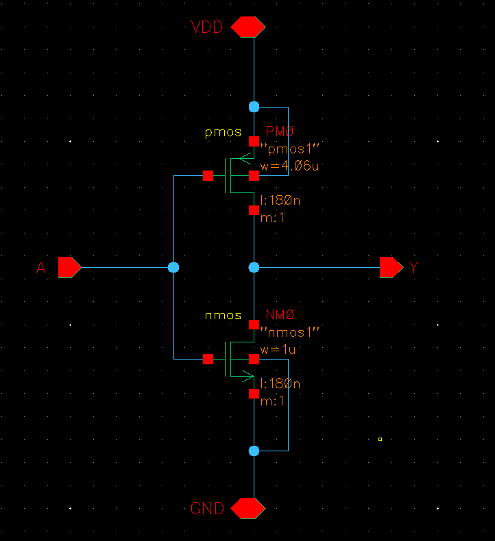
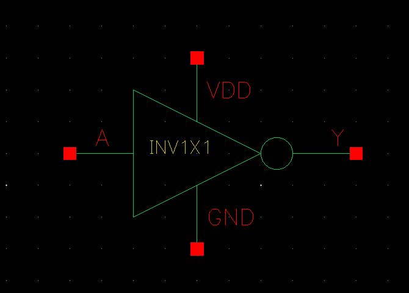
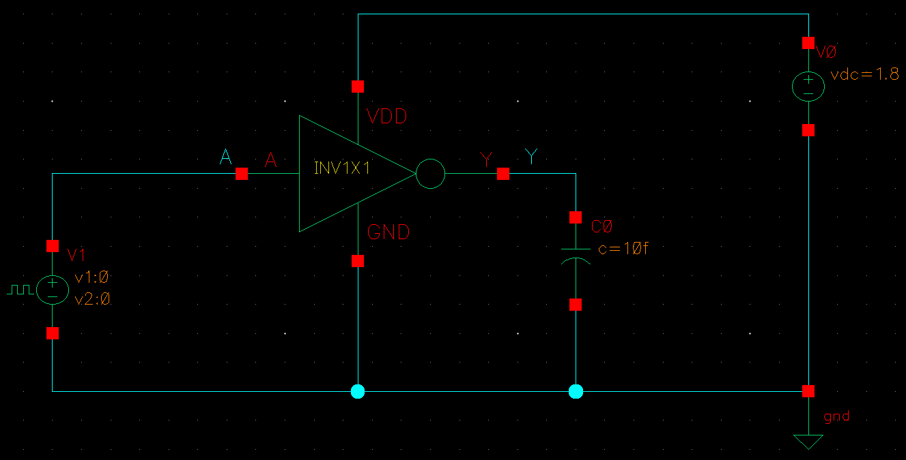
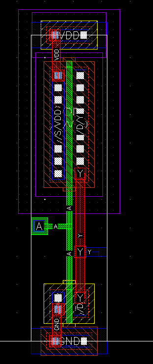
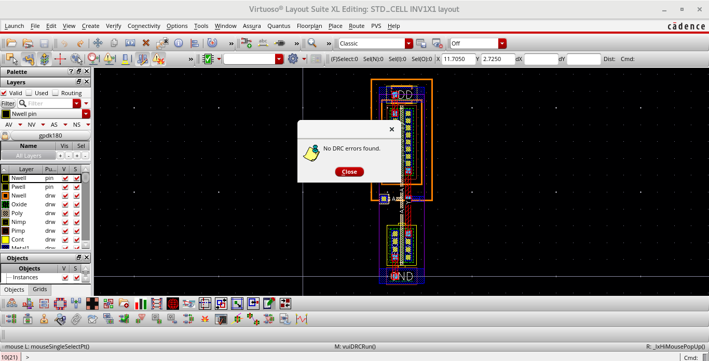
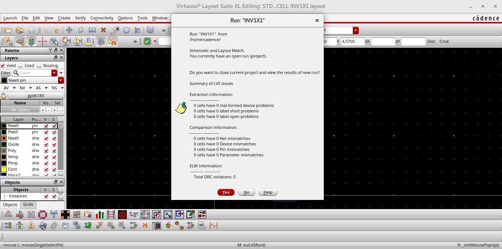

# INV1X1 — CMOS Inverter (1X Drive Strength)

A basic CMOS inverter designed in **Cadence Virtuoso**, taken through the full custom design flow: schematic → symbol → simulation → layout → DRC → LVS.

**Function:** `Y = NOT A`

| Input A | Output Y |
|:-------:|:--------:|
| 0 | 1 |
| 1 | 0 |

## Design Flow

| Step | What it means |
|------|---------------|
| Schematic | Transistor-level circuit: one PMOS (pull-up) and one NMOS (pull-down) |
| Symbol | A reusable block so the inverter can be placed in bigger circuits |
| Testbench | A test circuit with input pulse, supply and load to simulate the inverter |
| Simulation | Transient analysis in ADE using Spectre to check the output waveform |
| Layout | The physical drawing of the transistors and metal wiring on silicon |
| DRC | Design Rule Check: confirms the layout follows the foundry's manufacturing rules |
| LVS | Layout vs Schematic: confirms the layout is electrically the same circuit as the schematic |

---

## 1. Schematic
The PMOS connects the output to VDD when the input is low. The NMOS connects the output to GND when the input is high. Both gates are tied to input A, and both drains are tied to output Y.

## 2. Symbol
The schematic is wrapped into a symbol with pins A, Y, VDD and GND so it can be reused as one block.

## 3. Testbench
The symbol is placed in a testbench with a pulse source on the input, a DC supply, and a load capacitor on the output.

## 4. Symmetric Sizing
Holes in the PMOS move more slowly than electrons in the NMOS, so a PMOS of the same size is weaker. The PMOS is made wider than the NMOS so that rise time and fall time come out roughly equal. This gives a switching threshold near VDD/2.

## 5. Output Waveforms
The transient simulation shows the output is the inverse of the input, switching rail to rail.

## 6. Layout
The physical layout, with the PMOS in the N-well at the top and the NMOS at the bottom. The two share the poly gate (input) and the metal drain connection (output), with VDD and GND rails along the top and bottom.

## 7. DRC — Design Rule Check
DRC checks the layout against the foundry's geometric rules: minimum widths, spacings, enclosures and overlaps for every layer. A layout that breaks these rules can't be manufactured reliably.

**Result: no DRC violations.**

## 8. LVS — Layout vs Schematic
LVS pulls the transistors and connections out of the layout and compares them with the schematic netlist. A match means the drawn layout is the same circuit that was simulated.

**Result: the layout matches the schematic.**

---

## Tools
- Cadence Virtuoso (Schematic Editor, Layout Editor)
- ADE with Spectre (simulation)
- Physical verification for DRC and LVS
