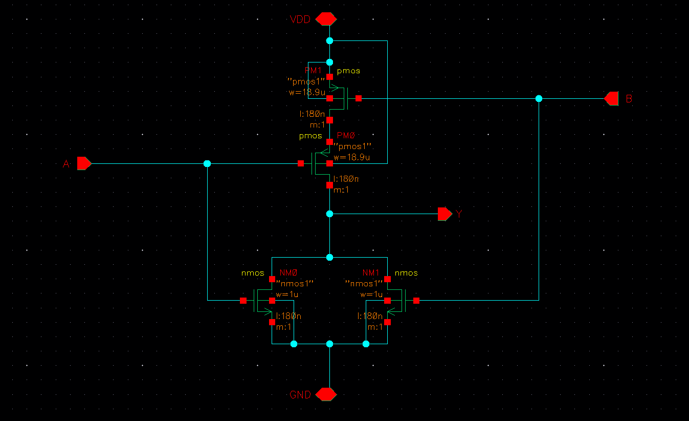
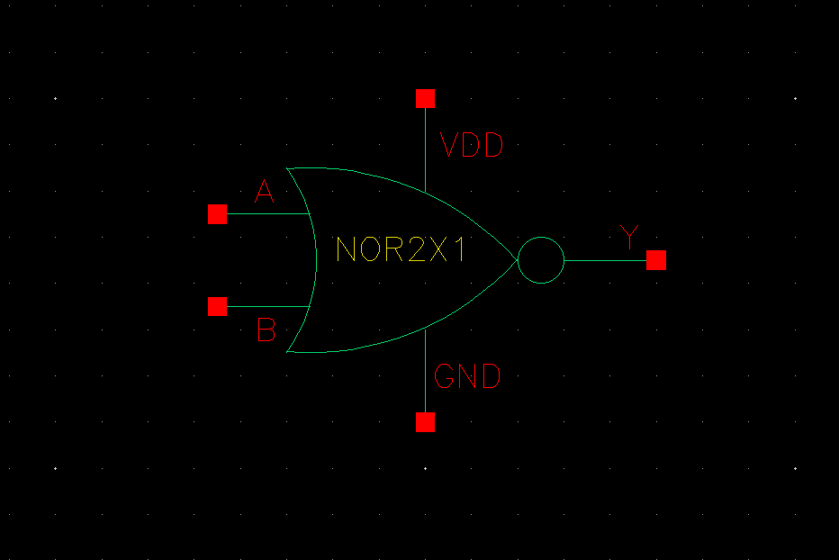
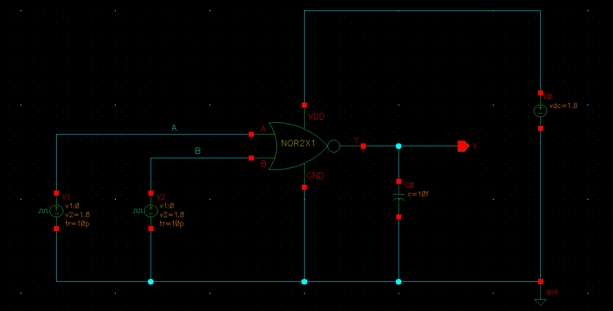
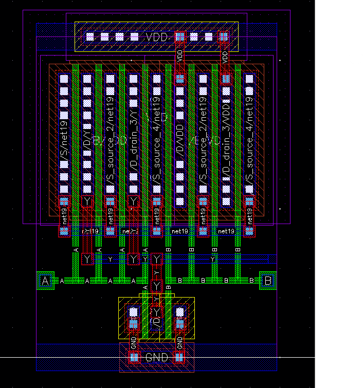
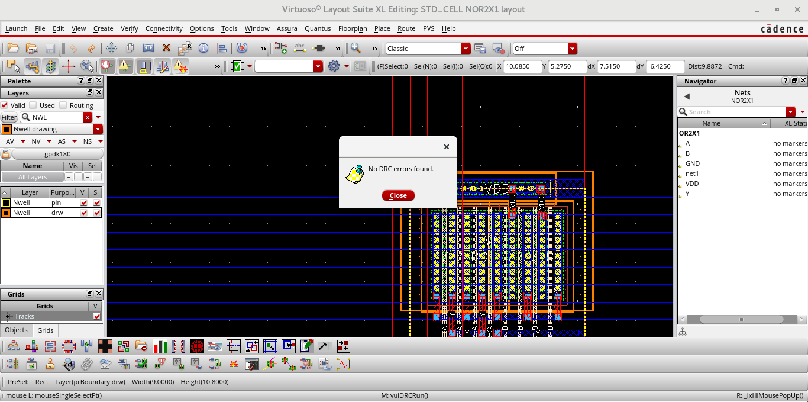
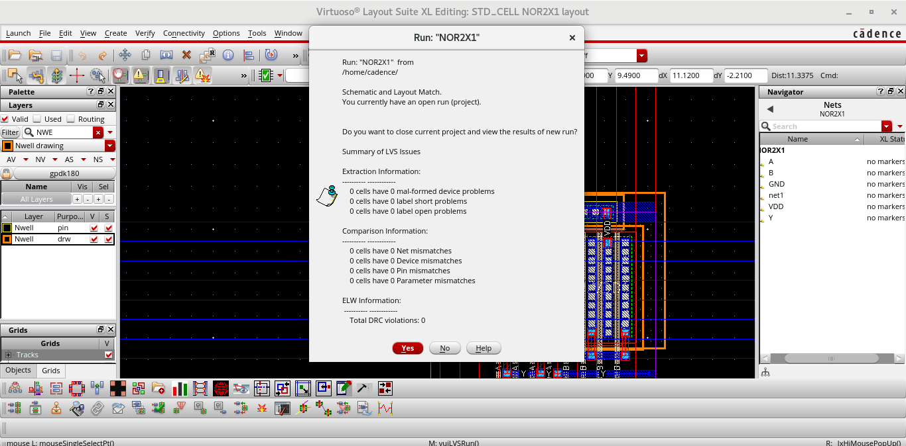

# NOR2X1 — 2-Input CMOS NOR Gate (1X Drive Strength)

A 2-input NOR gate designed in **Cadence Virtuoso**, taken through the full custom design flow: schematic → symbol → simulation → layout → DRC → LVS.

**Function:** `Y = NOT (A OR B)`

| A | B | Y |
|:-:|:-:|:-:|
| 0 | 0 | 1 |
| 0 | 1 | 0 |
| 1 | 0 | 0 |
| 1 | 1 | 0 |

## 1. Schematic
- **Pull-up network:** two PMOS transistors in **series**. The output is pulled to VDD only when both A and B are low.
- **Pull-down network:** two NMOS transistors in **parallel**. The output is pulled to GND when either input is high.

## 2. Symbol
The schematic is wrapped into a symbol with pins A, B, Y, VDD and GND for reuse in larger designs.

## 3. Testbench
Pulse sources with different periods drive A and B so that all four input combinations are covered, with a load capacitor on the output.

## 4. Sizing
The two PMOS transistors are in series, and PMOS is already weaker than NMOS, so each PMOS is made about twice as wide as in the inverter to keep rise time reasonable. The parallel NMOS transistors keep inverter sizing. This is why NOR gates take more area than NAND gates and are generally used less in CMOS design.

## 5. Output Waveforms
The output goes high only while both inputs are low, which matches the NOR truth table.

## 6. Layout
The series PMOS pair sits in the N-well at the top and the parallel NMOS pair at the bottom, with shared poly gates for A and B and VDD/GND rails.

## 7. DRC — Design Rule Check
Checks the layout against the foundry's minimum width, spacing and enclosure rules.

**Result: no DRC violations.**

## 8. LVS — Layout vs Schematic
Extracts the circuit from the layout and confirms it matches the schematic netlist.

**Result: the layout matches the schematic.**

---

## Tools
Cadence Virtuoso (Schematic, Layout), ADE with Spectre, physical verification for DRC/LVS
