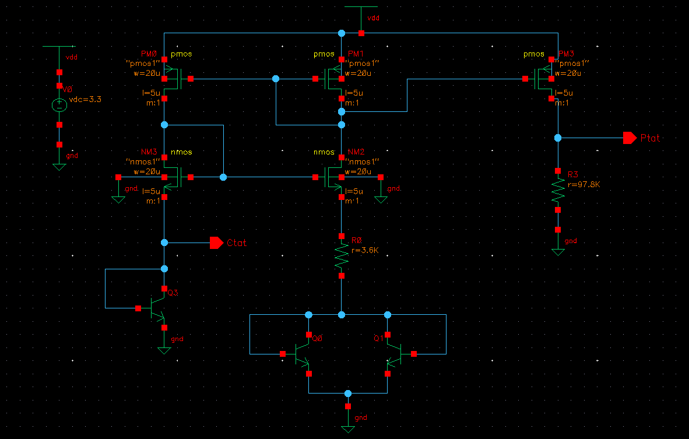
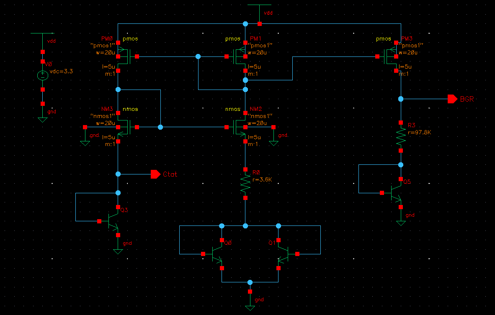
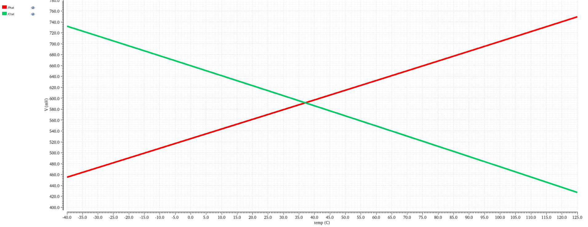
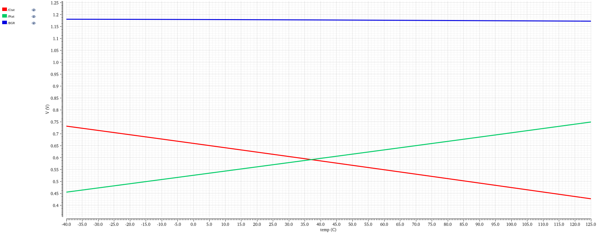

# Bandgap Voltage Reference

A bandgap reference (BGR) circuit designed in **Cadence Virtuoso**. It produces a stable reference voltage that stays nearly constant as temperature changes.

## Why a bandgap reference?
Analog and mixed-signal chips (ADCs, DACs, regulators, PLLs) need a reference voltage that doesn't drift with temperature or supply. A BGR does this by adding together two voltages that change with temperature in opposite directions.

## How it works

| Component | Behaviour with temperature | Source |
|-----------|----------------------------|--------|
| **CTAT** (Complementary To Absolute Temperature) | Decreases as temperature rises | Base-emitter voltage (V_BE) of a BJT |
| **PTAT** (Proportional To Absolute Temperature) | Increases as temperature rises | Difference in V_BE between two BJTs running at different current densities (ΔV_BE) |

With the PTAT term scaled correctly, the two slopes cancel:

`V_REF = V_BE + K · ΔV_BE`

The result is a reference close to the silicon bandgap voltage (about 1.2 V in theory), with very little change across temperature.

## 1. Schematic
The circuit uses BJTs to generate V_BE and ΔV_BE, resistors to set the PTAT scaling, and a feedback loop (op-amp or current mirror) that forces the required node voltages to be equal.

## 2. PTAT and CTAT Characteristics
A DC temperature sweep shows the PTAT voltage rising and the CTAT voltage falling with temperature.

## 3. Reference Voltage
Adding the two gives an output that stays nearly flat over the temperature range, which is the expected curved, almost-flat bandgap characteristic.

---

## Tools
Cadence Virtuoso (Schematic Editor), ADE with Spectre (DC temperature sweep)
